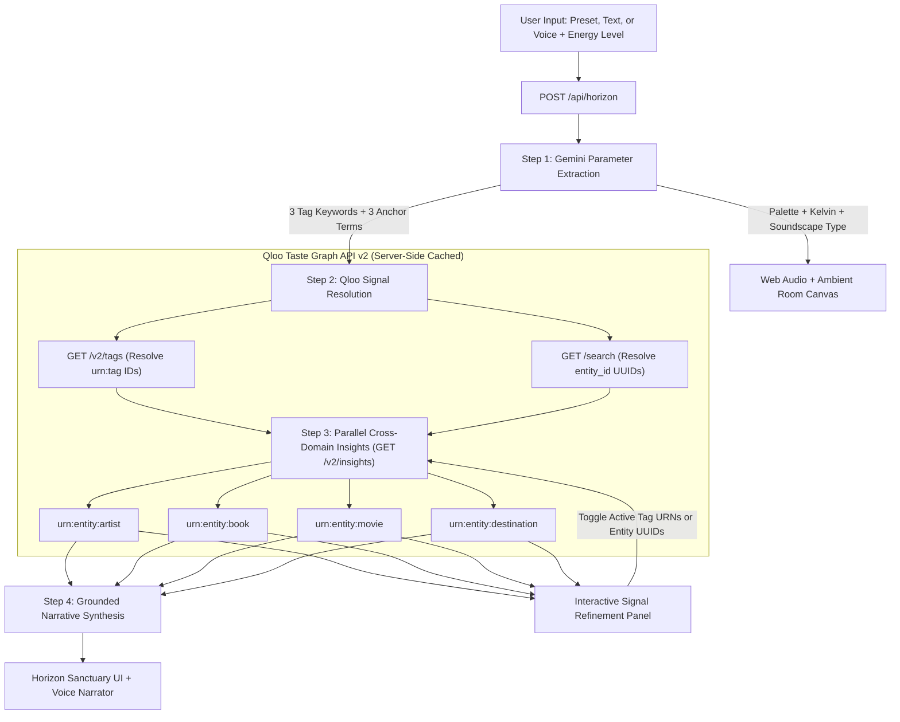

# Re:Horizon

[](https://nextjs.org/)
[](https://docs.qloo.com/)
[](https://ai.google.dev/)

Web application built for the **Qloo Agentic Hackathon**. It converts a short text or voice description of a desired environment and a selected energy level into cross-domain Qloo API v2 queries, a color gradient, procedural Web Audio output, and a short text summary.

## Live Demo and Testing

- **Live URL:** `https://re-horizon-seven.vercel.app/` (no login required)
- **Testing steps:**
  1. Select a preset, type a description, or use **Speak via Microphone**, then set the energy level (`minimal`, `low`, `moderate`).
  2. Click **Open Horizon Sanctuary** to run the server pipeline (`/api/horizon`).
  3. Test the audio generator (**Start Soundscape**), browser speech synthesis (**Eyes-Closed Voice Guide**), and full-screen view (**Ambient Room Mode**).
  4. In **Qloo Taste Graph & Provenance**, toggle any resolved tag (`urn:tag:...`) or entity ID on/off and click **Re-synthesize with Selected Signals** to re-run `/v2/insights` with the updated parameters.

## 1. Problem Statement

Searching across separate media catalogs requires multiple queries and manual filtering, which is impractical for users in confinement or with high fatigue. Standard LLM prompts generate text without verifying cross-domain entity relationships. Re:Horizon uses Gemini for structured parameter extraction and Qloo API v2 for retrieving correlated entities across music, books, movies, and destinations.

## 2. Qloo Workflow



The backend (`/api/horizon`) executes four steps:

1. **Parameter Extraction (Gemini):** Extracts 3 tag keywords, 3 anchor search terms, a soundscape preset (`ocean`, `rain`, `wind`, `warm-drone`), a color temperature integer (`2200`–`5000` K), and 3 hex colors.
2. **Signal Resolution (`GET /v2/tags`, `GET /search`):** Resolves keywords into Qloo tag URNs and search terms into Qloo entity UUIDs.
3. **Cross-Domain Insights (`GET /v2/insights`):** Queries four entity types in parallel using `signal.interests.tags` and `signal.interests.entities`:
   - `urn:entity:artist`
   - `urn:entity:book`
   - `urn:entity:movie`
   - `urn:entity:destination`
4. **Text Summary and Signal Refinement:** Generates a short text referencing the returned Qloo entities. The UI exposes all resolved tag URNs and entity UUIDs so the user can deselect specific signals and trigger a new `/v2/insights` request without re-running tag extraction.

## 3. Redacted Request-to-Result Flow

Example for input: *"quiet grounding, wet pine needles, cool air, soft natural light"* (`energyLevel: "low"`):

1. **Tag Lookup (`GET /v2/tags`):**
   - `GET https://hackathon.api.qloo.com/v2/tags?filter.query=pastoral&take=2` -> `urn:tag:neighborhood_characteristics:qloo:pastoral`, `urn:tag:style:qloo:pastoral`
   - `GET https://hackathon.api.qloo.com/v2/tags?filter.query=acoustic&take=2` -> `urn:tag:genre:music:acoustic`
   - `GET https://hackathon.api.qloo.com/v2/tags?filter.query=ambient&take=2` -> `urn:tag:genre:music:ambient`
2. **Entity Lookup (`GET /search`):**
   - `GET https://hackathon.api.qloo.com/search?query=<search_term>&take=1` -> resolves `entity_id` UUIDs (`E51DB8F2-...`, `BAA36D97-...`, `905A43B8-...`)
3. **Insights Query (`GET /v2/insights`):**
   - `GET https://hackathon.api.qloo.com/v2/insights?filter.type=urn:entity:artist&take=3&signal.interests.tags=...&signal.interests.entities=...` -> returns 3 artist entities with affinity scores and tags
   - Parallel requests with `filter.type=urn:entity:book`, `urn:entity:movie`, and `urn:entity:destination` -> return 3 matched entities per domain

*(All requests run server-side with header `X-Api-Key: [REDACTED]`).*

## 4. Setup

### Prerequisites
- Node.js `>=20.0.0`
- Qloo Hackathon API Key (`https://hackathon.api.qloo.com`)
- Google Gemini API Key

### Run Locally
1. Install dependencies:
   ```bash
   git clone https://github.com/vero-code/re-horizon.git
   cd re-horizon
   npm install
   ```
2. Create `.env` from `.env.example` and set your keys:
   ```bash
   cp .env.example .env
3.  Start the server:
    ```bash
    npm run dev
    
4.  Open `http://localhost:3000`.

## **5. Limitations and Safe Use**

-   **Server-Side Caching and Quota Protection:**  All Qloo API GET requests (`src/lib/qloo.ts`) use private server-side caching (`revalidate: 3600`  seconds) to prevent redundant calls for identical tag or entity lookups and respect the hackathon rate and quota limits.
-   **Aggregate Data Only:**  Qloo results represent aggregate cultural correlations. This application does not provide medical advice, diagnosis, or treatment.
-   **No Personal Data:**  Only general descriptive keywords and public work/genre terms are sent to Qloo.
-   **Browser APIs:**  Audio synthesis uses Web Audio API; speech synthesis and microphone input use Web Speech API (supported in desktop Chrome and Edge).

## **License**

Apache License 2.0 — see LICENSE.